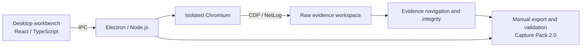

<h1 align="center">KVM-Recon</h1>

<p align="center">
  <strong>Offline BMC / HTML5 KVM evidence capture</strong>
</p>

<p align="center">
  <a href="LICENSE"></a>
  <a href="https://github.com/zzugbb/KVM-Recon/releases"></a>
  <a href="https://github.com/zzugbb/KVM-Recon/actions/workflows/ci.yml?query=branch%3Amain"></a>
  <a href="https://github.com/zzugbb/KVM-Recon/actions/workflows/showcase-pages.yml?query=branch%3Amain"></a>
</p>

<p align="center">
  <a href="https://zzugbb.github.io/KVM-Recon/">Showcase</a> ·
  <a href="#project-demo">Video</a> ·
  <a href="https://zzugbb.github.io/KVM-Recon/#cases">Cases</a> ·
  <a href="https://github.com/zzugbb/KVM-Recon/releases/tag/v0.3.0">Download</a> ·
  <a href="docs/status.md#系统架构与技术实现">Architecture</a> ·
  <a href="docs/README.md">Docs</a> ·
  <a href="CONTRIBUTING.md">Contribute</a>
</p>

<p align="center"><a href="README.md">简体中文</a> | <strong>English</strong></p>

---

## Overview

KVM-Recon is an offline macOS / Windows desktop client for server rooms without public internet access. It records browser-visible facts while an operator manually logs into a BMC and opens HTML5 KVM, then manually exports **Capture Pack 2.0** for engineers or authorized AI to investigate off-site.

Capture does not rely on vendor, model or protocol-family rules. The tool does not automate login, perform MITM, call external AI, generate adapters or fully decode video protocols. Original evidence is **unredacted** and must remain in controlled storage and handoff channels.

The application version is **0.3.0**. Historical 0.2.x packs and YES / PARTIAL / NO results are not Capture Pack 2.0 integrity verdicts. The client UI and detailed guides are Chinese.

## Project demo

A 96-second project introduction video. Play the 720p version below (about 9.9 MB), or download the 1080p original.

https://github.com/user-attachments/assets/bb067c0c-5118-45ce-aeeb-b0b4935e9243

[Download 1080p original](https://github.com/zzugbb/KVM-Recon/raw/refs/heads/main/docs/assets/kvm-recon-promo-v3-1080p.mp4) · [Open interactive showcase](https://zzugbb.github.io/KVM-Recon/)

## Showcase

[Overview](https://zzugbb.github.io/KVM-Recon/) · [Internal workflow](https://zzugbb.github.io/KVM-Recon/#workflow) · [Synthetic cases](https://zzugbb.github.io/KVM-Recon/#cases) · [Architecture](https://zzugbb.github.io/KVM-Recon/#architecture)

The independent static site covers positioning, capabilities, architecture, processing and evidence browsing. The complete case uses a public Mock sample; the missing-evidence case uses an actual integrity-engine fault fixture. It requires no login or backend, never connects to real machines and does not establish real-device compatibility. Preview and Pages publishing instructions are in the [showcase guide](showcase/README.md); see the Pages workflow above for deployment results.

## Capabilities

| Capability | Output |
| --- | --- |
| Browser evidence | HTTP / HAR, bodies, network and dynamic scripts, Workers / WASM, state, screenshots, actions and observable realtime channels; unreadable content is an explicit gap |
| Offline research | Candidate request chains, stable IDs, observed value propagation, missing evidence and Replay plans reference original artifacts |
| Integrity and validation | Separate workflow progress and ten integrity gates; export checks Schema, references, sizes and SHA-256 |
| Storage and recovery | Content addressing, deduplication, streaming ZIP64, a single job, disk safeguards and interrupted-workspace recovery export |

`captureIntegrity` reports COMPLETE / INCOMPLETE; `workflowStatus` reports observed login or KVM stages. An unfamiliar architecture can be COMPLETE when evidence and gates are satisfied; this does not guarantee protocol identification or an immediately implementable adapter. WebTransport currently records lifecycle events and reports a payload gap.

Electron / Chromium provide observation, React / TypeScript provide the workbench, and Node.js handles files and streams. Module responsibilities, design choices and actual coverage are in [architecture and validation](docs/status.md).

## Architecture



The diagram shows the main modules and data relationships; observation, storage and derivation cooperate continuously. Original facts are saved first, derived results remain traceable, and export remains a manual decision after finalization. See [architecture details](docs/status.md#系统架构与技术实现).

## Download and use

Get macOS / Windows installers from the [v0.3.0 Release](https://github.com/zzugbb/KVM-Recon/releases/tag/v0.3.0), and verify `SHA256SUMS.txt`.

macOS builds are ad-hoc signed without notarization; Windows builds have no Authenticode signature. Downloads may show unknown developer / publisher prompts; see [installation and signing](docs/releasing.md#产物).

1. Open the client, enter the BMC address and optional free-text device label, then start capture.
2. Manually log in through the isolated capture browser and open HTML5 KVM; keep Viewer popups open.
3. Wait for automatic finalization or stop manually. **Automatic finalization does not export.**
4. Review integrity and gaps, then manually export. Once export validation succeeds, begin with `00_START_HERE.md` inside the pack.

HAR is included, so a separate Chrome HAR export is unnecessary. Incomplete packs can be exported for investigation; interrupted workspaces can be exported or retained. Details are in the [field guide](docs/field-guide.md) and [pack reading guide](docs/capture-pack-guide.md).

## Local development

Requires Node.js 22+ (see `.nvmrc`) and npm:

```bash
npm ci
npm run dev
```

Run `npm run typecheck`, `npm test` and `npm run build` as appropriate for the change. Electron end-to-end checks use `npm run test:e2e` after building. Validation commands, optional field HAR replay and contribution rules are in [CONTRIBUTING.md](CONTRIBUTING.md); packaging and releases are in the [release guide](docs/releasing.md).

## Docs and feedback

The [documentation index](docs/README.md) organizes field capture, offline research, development and releases:

- [Capture and data contract](docs/v0.3-development-spec.md): execution boundaries, file layout and integrity rules.
- [Architecture and project status](docs/status.md): source entry points, validation evidence and coverage.
- [Schema](schema/2.0/README.md) / [synthetic sample](examples/README.md): validation and file examples.
- [Issues](https://github.com/zzugbb/KVM-Recon/issues/new/choose) / [contribution guide](CONTRIBUTING.md) / [code of conduct](CODE_OF_CONDUCT.md).

Packs and recovery workspaces may contain passwords, Cookies, Tokens, internal addresses and channel payloads. **Never attach them to public Issues.** Capture windows relax some browser security restrictions; connect only to trusted BMCs. Report vulnerabilities privately through [Security Advisories](https://github.com/zzugbb/KVM-Recon/security/advisories/new); see [SECURITY.md](SECURITY.md).

## License

[MIT](LICENSE) · [Changelog](CHANGELOG.md)
