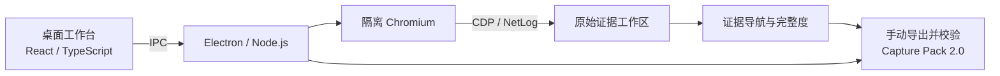

<h1 align="center">KVM-Recon</h1>

<p align="center">
  <strong>BMC / HTML5 KVM 离线证据采集工具</strong>
</p>

<p align="center">
  <a href="LICENSE"></a>
  <a href="https://github.com/zzugbb/KVM-Recon/releases"></a>
  <a href="https://github.com/zzugbb/KVM-Recon/actions/workflows/ci.yml?query=branch%3Amain"></a>
  <a href="https://github.com/zzugbb/KVM-Recon/actions/workflows/showcase-pages.yml?query=branch%3Amain"></a>
</p>

<p align="center">
  <a href="https://zzugbb.github.io/KVM-Recon/">在线展示</a> ·
  <a href="https://zzugbb.github.io/KVM-Recon/#cases">合成案例</a> ·
  <a href="https://github.com/zzugbb/KVM-Recon/releases/tag/v0.3.0">下载安装包</a> ·
  <a href="docs/status.md#系统架构与技术实现">架构</a> ·
  <a href="docs/README.md">文档</a> ·
  <a href="CONTRIBUTING.md">贡献</a>
</p>

<p align="center"><strong>简体中文</strong> | <a href="README.en.md">English</a></p>

---

## 项目简介

KVM-Recon 是面向无公网机房的 macOS / Windows 桌面客户端：记录现场人员「手工登录 BMC → 打开 HTML5 KVM」时浏览器实际观察到的事实，手动导出 **Capture Pack 2.0**，供离场后的工程师或获授权的 AI 研究适配。

采集不依赖厂商、型号或协议族规则。工具负责留下证据，不自动登录、不做 MITM、不调用机房外 AI、不生成 Adapter，也不解码完整视频协议。原始资料**未脱敏**，只在受控环境保存和交接。

当前应用版本为 **0.3.0**。历史 0.2.x 的旧包与 YES / PARTIAL / NO 结果不能当作 2.0 完整度结论。

## 在线展示

[展示首页](https://zzugbb.github.io/KVM-Recon/) · [内部工作流程](https://zzugbb.github.io/KVM-Recon/#workflow) · [合成案例](https://zzugbb.github.io/KVM-Recon/#cases) · [系统架构](https://zzugbb.github.io/KVM-Recon/#architecture)

独立静态站展示定位、能力、架构、处理流程与证据浏览。完整案例来自公开 Mock 样例，缺口案例来自实际完整度引擎处理的故障 Fixture；无需登录或后端，不连接真实机器，不替代真机验收。运行与 Pages 发布方法见[展示说明](showcase/README.md)，部署结果见上方 Pages 工作流。

## 核心能力

| 能力 | 交付内容 |
| --- | --- |
| 浏览器证据 | HTTP / HAR、正文、网络与动态脚本、Worker / WASM、状态、截图、动作及可观察实时通道；不可读取的内容明确记缺口 |
| 离线研究 | 候选请求链、稳定 ID、已观察值传播、缺失证据及 Replay 计划，沿引用复核原始工件 |
| 完整度与校验 | 独立的工作流进展与十项门禁；导出时检查 Schema、引用、字节数和 SHA-256 |
| 磁盘与恢复 | 内容寻址去重、流式 ZIP64、单作业、磁盘水位保护及异常资料恢复导出 |

`captureIntegrity` 表示 COMPLETE / INCOMPLETE，`workflowStatus` 表示是否观察到登录或 KVM 等阶段。未知架构满足证据与门禁要求也可 COMPLETE；完整度不保证协议已识别或 Adapter 一次实现。WebTransport 当前只记录生命周期并报告 payload 缺口。

Electron / Chromium 提供观测环境，React / TypeScript 提供工作台，Node.js 负责文件与流。模块职责、设计取舍与实际覆盖见[架构及验证基线](docs/status.md)。

## 系统架构



图中为主要模块与数据关系；观测、落盘和派生持续协作。原始事实先保存，派生结论可追溯，自动收尾后仍由用户决定导出。详细模块和技术取舍见[架构说明](docs/status.md#系统架构与技术实现)。

## 下载与使用

从 [v0.3.0 Release](https://github.com/zzugbb/KVM-Recon/releases/tag/v0.3.0) 下载 macOS / Windows 安装包，并核对 `SHA256SUMS.txt`。

当前 macOS 为 ad-hoc 签名、未公证；Windows 无 Authenticode 签名。下载后可能提示未知开发者 / 发布者，处理方式见[安装与签名说明](docs/releasing.md#产物)。

1. 打开客户端，输入 BMC 地址与可选的自由文本设备说明，点击“开始采集”。
2. 在独立采集浏览器中手工登录并打开 HTML5 KVM，保持 Viewer 弹窗打开。
3. 等待稳定后自动收尾，或点击“停止并收尾”；**自动收尾不会自动导出**。
4. 核对完整度与缺口，手动导出。成功显示“已导出并校验”后，离场按包内 `00_START_HERE.md` 阅读。

HAR 已随包保存，不必另开 Chrome 手工导出。未完整包仍可导出用于排查；异常退出后可恢复导出或保留原始资料。详细步骤见[现场指南](docs/field-guide.md)，离线分析见[采集包阅读指南](docs/capture-pack-guide.md)。

## 本地开发

需要 Node.js 22+（见 `.nvmrc`）与 npm：

```bash
npm ci
npm run dev
```

提交前按变更范围执行 `npm run typecheck`、`npm test`、`npm run build`；Electron 端到端验证使用 `npm run test:e2e`，须先构建。完整验证命令、可选现场 HAR 回放与贡献约定见[贡献指南](CONTRIBUTING.md)。安装包构建与发版见[发布指南](docs/releasing.md)。

## 文档与反馈

[文档导航](docs/README.md)按现场采集、离线研究、开发及发布组织入口：

- [采集与数据契约](docs/v0.3-development-spec.md)：执行边界、文件结构与完整度规则。
- [架构与项目状态](docs/status.md)：实现入口、验证证据及覆盖范围。
- [Schema](schema/2.0/README.md) / [合成样例](examples/README.md)：结构校验与文件示例。
- [普通问题](https://github.com/zzugbb/KVM-Recon/issues/new/choose) / [贡献指南](CONTRIBUTING.md) / [行为准则](CODE_OF_CONDUCT.md)。

采集包、恢复工作区可能包含口令、Cookie、Token、内网地址与通道载荷，**不要提交公开 Issue**。采集窗口放宽部分浏览器安全限制，只连接可信 BMC。漏洞通过 [Security Advisories](https://github.com/zzugbb/KVM-Recon/security/advisories/new) 私下报告，详见[安全说明](SECURITY.md)。

## 许可

[MIT](LICENSE) · [版本记录](CHANGELOG.md)
