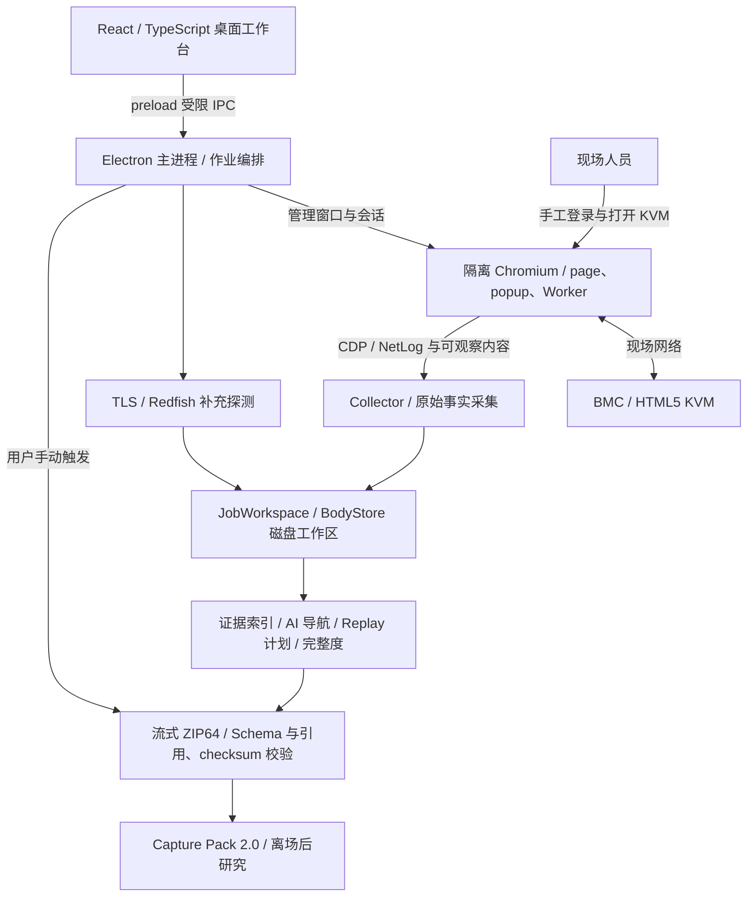

# 项目状态与维护范围

当前源码版本为 **0.3.1**，使用 **Capture Pack 2.0**。本文集中说明当前能力、验证基线与维护范围；数据契约见[采集与数据契约](v0.3-development-spec.md)。

## 产品定位

面向无公网机房的 macOS / Windows 桌面客户端，记录操作员从登录 BMC 到打开 HTML5 KVM 的浏览器可观察事实，并由用户手动导出采集包。包内原始资料不脱敏，供离场后工程师或获授权的 AI 研究适配。

设备说明是自由文本，不参与采集或完整度判断。产品范围止于导出 Capture Pack：不分类厂商或协议族，不自动登录、不做 MITM、不调用机房外 AI、不生成 Adapter，也不解码完整视频协议。

## 当前实现

| 能力 | 实现入口 | 行为 |
| --- | --- | --- |
| 单作业与恢复 | `src/core/job-workspace/` | 跨进程互斥、磁盘水位、收尾不可变；异常作业可手动导出或保留原始资料 |
| 原始正文 | `src/core/body-store/` | SHA-256 内容寻址、去重与流式写入 |
| 浏览器采集 | `src/core/collector/` | CDP / NetLog、HTTP / HAR、脚本 / Worker / WASM、浏览器状态、截图与实时通道；不可观察内容记缺口 |
| 证据与完整度 | `src/core/capture-pack-v2/` | 工作流状态、十项门禁、包内事实读取、Schema 与一致性校验 |
| 证据导航与 Replay | `src/core/collector/` | 依据实际事实生成候选请求链、值传播、缺失证据与回放计划，不输出协议分类 |
| 导出 | `src/core/export/` | 手动触发流式 ZIP64，校验引用和 checksum 后生成正式文件 |
| 桌面工作台 | `src/main/`、`src/renderer/` | 单屏单作业、当前状态与主操作、计数器、最近事实、高级诊断与崩溃恢复 |

Viewer 活动稳定后自动收尾，持续绘帧不重置稳定等待；收尾只停止采集，导出仍由用户触发并完成 ZIP 自校验。操作步骤与等待条件见[现场指南](field-guide.md)，完整规则见[数据契约 §7](v0.3-development-spec.md#7-采集生命周期)。

`COMPLETE` 只能与 `KVM_REACHED` 组合，说明定义范围内的观察证据通过门禁，不保证任何设备必然采集完整，也不保证仅凭一包能完成 Adapter。

## 系统架构与技术实现

这是模块职责与数据关系图，观测、写入与派生会持续协作，不表示所有模块按图严格串行执行。`src/preload/index.ts` 通过 `contextBridge` 暴露作业操作；`src/main/capture/productionCaptureController.ts` 管理窗口、采集会话、收尾和手动导出；正文和事件保留在磁盘工作区，派生资料不能替代原始证据。

技术栈以仓库源码和 `package.json` 为准：Electron / Chromium 承载桌面与浏览器观测；React / TypeScript 实现工作台与类型契约；Node.js 处理文件与流；AJV 校验 JSON Schema；yazl / yauzl 写入并重新打开 ZIP 复核。展示站是独立静态页面，不属于这条运行链路。

设计取舍：先留事实再判断，以覆盖未知架构；内容寻址和流式落盘控制重复存储与内存占用；完整度与工作流进展分开，避免“看到了 Viewer”掩盖采集缺口；收尾与导出分开，让现场人员决定交接时机。相关实现入口见上表，数据与执行边界仍以[采集与数据契约](v0.3-development-spec.md)为准。

## 验证基线

本基线适用于已发布的 **0.3.1**（buildId `dd3cc85a7dfcf34a`），核验日期为 **2026-11-03**。本地验证环境为 macOS arm64 / Electron 45.2.0；以下结论仅覆盖列出的场景。复验命令见[贡献指南](../CONTRIBUTING.md)，打包与发布门禁见[发布指南](releasing.md)。

| 验证面 | 当前结论 | 覆盖范围 |
| --- | --- | --- |
| 源码与依赖 | 通过 | 独立源码快照执行 `npm ci`；类型检查、单测、构建及样例一致性检查；包内文档检查覆盖 Unix / Windows 路径、真实缺失及空产物 |
| 采集与导出 | 通过 | Electron E2E：启动、popup、生产采集、异常关窗、Mock 登录 / Viewer / 双向 WS、ZIP 自校验与动态值 Replay |
| 持续绘帧收尾 | 通过 | Chromium 持续 rAF 回归通过，旧逻辑负向对照按预期超时；用户确认原问题设备新版复测通过，对应现场包记录为 `COMPLETE + KVM_REACHED` |
| 现场语料回放 | 通过 | 三份代表 HAR 的离线 HTTP 回放；不执行真实设备登录，不证明实时视频通道兼容 |
| macOS arm64 包体 | 通过 | 应用目录打包、版本 / buildId / ASAR 内容、深度签名、隔离启动与包内采集导出；随包文档链接检查已纳入发布门禁 |
| GitHub 发布 | 已发布 | [v0.3.1 Release](https://github.com/zzugbb/KVM-Recon/releases/tag/v0.3.1) 已包含 macOS x64 / arm64、Windows x64 安装包和 `SHA256SUMS.txt`；产物上传不等同于各平台安装验收 |
| 文档与公开展示 | 通过 | 本地文档链接；展示站 8 项测试、根路径及 Pages 子路径的桌面 / 手机交互；本地视频解码与抽帧文字核对，素材范围见[视频说明](assets/README.md) |

**待验证范围：**新版 Windows 与 macOS x64 安装运行、Pages 线上部署验收、远端 720p 视频。macOS arm64 应用目录验证不等同于 DMG 安装验收，路径模拟测试不等同于 Windows 安装验收；旧版真机和安装反馈不作为新版通过依据。

**未发布修复：**当前源码修复了两类时序问题：Viewer 打开后通道先于渲染表面建立时漏判活动；收尾期间在途 HTTP 响应因排空时间不足而缺失。类型检查、单测、构建及完整 Electron E2E 通过，覆盖通道与表面顺序、自动收尾、延迟响应、重定向、多窗口、超时与持续流。现场漏判包只读重算后由 `LOGIN_REACHED` 恢复为 `KVM_REACHED`；HTTP 修复后的现场手动收尾包正文门禁通过。两项修复均未包含在已发布的 0.3.1 中，合并修复后的真机自动收尾与完整导出仍待复测。

其他设备 / 固件、复杂 popup / OOPIF / ServiceWorker 及真实 WebRTC / WebTransport 尚无同等级真机验证。WebTransport 只记录生命周期并报告 payload 缺口，通道目录存在不代表完整采集。

## 维护与交接

- 围绕可复现的采集、恢复、导出、契约及打包问题维护；变更同步受影响文档和验证范围。
- 旧 0.2.x 链路、协议分类、旧格式 Schema、多作业与包对比不在当前实现中；历史从 Git 标签查阅。
- 现场语料和 InManage 是仓库外资产，文档整理和回归不修改它们，也不提交其中的凭据。
- 下游从[采集包阅读指南](capture-pack-guide.md)进入证据，协议归属与 Adapter 实现由下游项目判断。
- 安装包构建、签名和发布见[发布指南](releasing.md)。

## 公开展示

独立静态站位于 `showcase/`，展示定位、能力、系统架构、内部工作流程与合成案例，不连接真实 BMC。完整样例与故障 Fixture 的素材边界见[展示说明](../showcase/README.md)。展示站不属于桌面安装包，不改变采集与导出契约。
