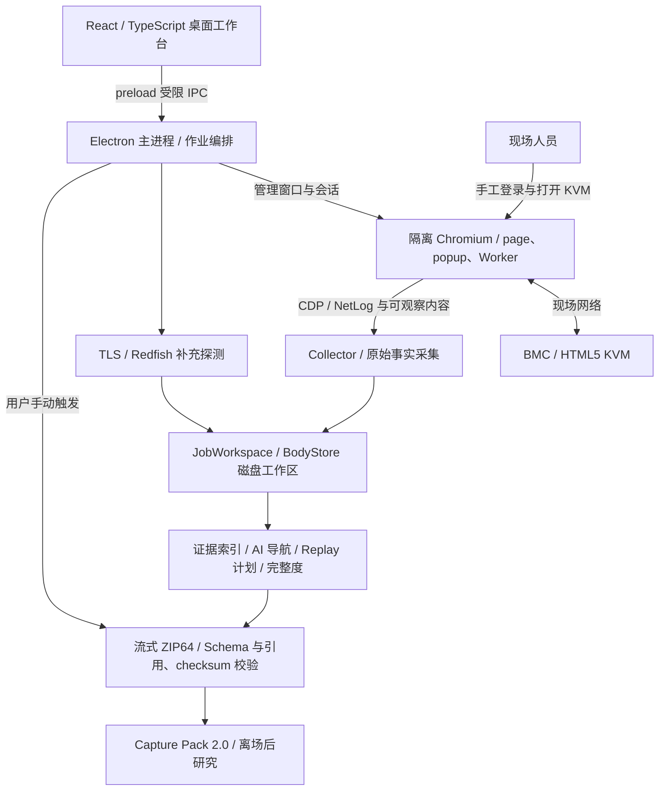

# 项目状态与维护范围

当前源码版本为 **0.3.0**，使用 **Capture Pack 2.0**。本文集中说明当前能力、验证基线与维护范围；数据契约见[采集与数据契约](v0.3-development-spec.md)。

## 产品定位

面向无公网机房的 macOS / Windows 桌面客户端，记录操作员从登录 BMC 到打开 HTML5 KVM 的浏览器可观察事实，并由用户手动导出采集包。包内原始资料不脱敏，供离场后工程师或获授权的 AI 研究适配。

设备说明是自由文本，不参与采集或完整度判断。产品范围止于导出 Capture Pack：不分类厂商或协议族，不自动登录、不做 MITM、不调用机房外 AI、不生成 Adapter，也不解码完整视频协议。

## 当前实现

| 能力 | 实现入口 | 行为 |
| --- | --- | --- |
| 单作业与恢复 | `src/core/job-workspace/` | 跨进程互斥、磁盘水位、收尾不可变；异常作业可手动导出或保留原始资料 |
| 原始正文 | `src/core/body-store/` | SHA-256 内容寻址、去重与流式写入 |
| 浏览器采集 | `src/core/collector/` | CDP / NetLog、HTTP / HAR、脚本 / Worker / WASM、浏览器状态、截图与实时通道；不可观察内容记缺口 |
| 证据与完整度 | `src/core/capture-pack-v2/` | 工作流状态、十项门禁、包内事实读取、Schema 与一致性校验 |
| 证据导航与 Replay | `src/core/collector/` | 依据实际事实生成候选请求链、值传播、缺失证据与回放计划，不输出协议分类 |
| 导出 | `src/core/export/` | 手动触发流式 ZIP64，校验引用和 checksum 后生成正式文件 |
| 桌面工作台 | `src/main/`、`src/renderer/` | 单屏单作业、当前状态与主操作、计数器、最近事实、高级诊断与崩溃恢复 |

Viewer 活动检出后，15 秒稳定窗口会随新 Target、通道、导航或动作重置；在途非持续 HTTP 请求和初始截图仍未完成时推迟收尾。自动收尾只停止采集，不导出、不关闭采集窗口。收尾后显示的完整度仍需在 ZIP 导出时完成文件自校验。

`COMPLETE` 只能与 `KVM_REACHED` 组合，说明定义范围内的观察证据通过门禁，不保证任何设备必然采集完整，也不保证仅凭一包能完成 Adapter。

## 系统架构与技术实现

这是模块职责与数据关系图，观测、写入与派生会持续协作，不表示所有模块按图严格串行执行。`src/preload/index.ts` 通过 `contextBridge` 暴露作业操作；`src/main/capture/productionCaptureController.ts` 管理窗口、采集会话、收尾和手动导出；正文和事件保留在磁盘工作区，派生资料不能替代原始证据。

技术栈以仓库源码和 `package.json` 为准：Electron / Chromium 承载桌面与浏览器观测；React / TypeScript 实现工作台与类型契约；Node.js 处理文件与流；AJV 校验 JSON Schema；yazl / yauzl 写入并重新打开 ZIP 复核。展示站是独立静态页面，不属于这条运行链路。

设计取舍：先留事实再判断，以覆盖未知架构；内容寻址和流式落盘控制重复存储与内存占用；完整度与工作流进展分开，避免“看到了 Viewer”掩盖采集缺口；收尾与导出分开，让现场人员决定交接时机。相关实现入口见上表，数据与执行边界仍以[采集与数据契约](v0.3-development-spec.md)为准。

## 验证基线

以下是已有证据的汇总，不表示当前工作树重新执行了这些测试。开发经过从 Git 历史查询。

| 日期 | 范围 | 结果与边界 |
| --- | --- | --- |
| 2026-09-24 | 类型检查、单测、构建与 Electron E2E | 通过；包含 Mock 登录 / Viewer / WS、导出与动态值新会话 Replay，不代表所有 BMC 固件 |
| 2026-09-24 | 16 份现场 HAR 离线 HTTP 回放 | 16/16 通过；同 method/path 只取首条，304 以 200 重放；101 握手不等于 WS 帧载荷验证，不执行真实登录 |
| 2026-09-24 | 63 个历史 ZIP | ZIP、manifest / HAR / HTTP JSONL 可读，HAR 与 JSONL 计数一致；只是旧资料可读性检查，不升级为 2.0，也不证明新采集覆盖 |
| 2026-09-24 | macOS 双架构产物 | x64 / arm64 DMG 与 ZIP、签名校验通过；arm64 应用隔离启动烟测通过，ad-hoc 且未公证 |
| 2026-09-24 | 同一家庭 BMC 的 2.0 实采 | `COMPLETE + KVM_REACHED`，十门禁通过，308 个条目逐项 SHA-256 与包内一致性检查通过；旧包 22 份 JS 按 hash 命中，66 个不同 method/path 在新索引中出现 |
| 2026-09-28 | 最终本地回归 | 类型检查、603/603 单测、构建、Electron E2E（三份代表 HAR）、macOS arm64 应用目录打包与差异检查通过；最终小范围写入失败修复后未重跑全量 16 份 HAR，未新增真机采集 |
| 2026-09-28 | 合成样例与独立包复核 | 样例逐字节一致性 12/12、Schema 校验通过；另一个 308 条目 ZIP 的 307 条 checksum 覆盖其余工件并校验通过，不能据此认定它就是上表真机包 |
| 2026-09-28 | 发布后维护者反馈 | macOS / Windows 安装包下载测试，并用一台家庭 BMC 成功导出；未记录两平台各自的端到端导出状态与自校验数据 |

家庭 BMC 的 `No Signal` 经维护者确认是现场正常 KVM 显示，不据此要求重采。历史记录中的 67 条 WS 帧未重新核实包身份和二进制 / 总帧统计口径，不用于推断其他包的缺口。同一设备两次会话的动态正文不能宣称逐字节相同。

现场 HAR 默认 E2E 仅跑三份代表文件；持有外部语料时设置 `KVM_RECON_FIELD_COLLECTION_2`，再设置 `KVM_RECON_FIELD_HAR_ALL=1` 才回放全部 16 份。历史 ZIP / HAR 均只读并留在仓库外。

其他设备或固件、复杂 popup / OOPIF / ServiceWorker 及真实 WebRTC / WebTransport 未获得同等级真机证据。WebTransport 当前只记录生命周期并标记 payload 不可观察缺口；不能把通道目录存在视为完整采集。单测 / Mock、历史打包和安装反馈各有边界，不替代对应提交或目标设备的验收。

## 维护与交接

- 围绕可复现的采集、恢复、导出、契约及打包问题维护；变更同步受影响文档和验证范围。
- 旧 0.2.x 链路、协议分类、旧格式 Schema、多作业与包对比不在当前实现中；历史从 Git 标签查阅。
- 现场语料和 InManage 是仓库外资产，文档整理和回归不修改它们，也不提交其中的凭据。
- 下游从[采集包阅读指南](capture-pack-guide.md)进入证据，协议归属与 Adapter 实现由下游项目判断。
- 安装包构建、签名和发布见[发布指南](releasing.md)。

## 公开展示

独立静态站位于 `showcase/`，展示定位、能力、系统架构、内部工作流程与合成案例，不连接真实 BMC。完整样例与故障 Fixture 的素材边界见[展示说明](../showcase/README.md)。展示站不属于桌面安装包，不改变采集与导出契约。
